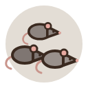

# Dodo Clash

> *Mauritius, 1598. For a million years the dodo had no enemies. Then the ships came.*

A co-op browser strategy game for 2–6 colleagues, played in short breaks over one office week.
Together you lead the dodos and their native allies against the pigs, rats and sailors the
ships brought to the island. The clock only runs during office hours.

  
  
  
  
  

## Status

The design is settled and placeholder art exists, but there is **no code yet**. Next up is
milestone 1: a small map with one flock moving on a live clock.

## Read more

| File | What's in it |
|---|---|
| [DESIGN.md](DESIGN.md) | The game: map, time, clans, invaders, combat, interface and milestones |
| [ARCHITECTURE.md](ARCHITECTURE.md) | How it's built |
| [TECH_RESEARCH.md](TECH_RESEARCH.md) | Research behind the stack |
| [GAMERULES.md](GAMERULES.md), [WORLD.md](WORLD.md) | Notes on the genre reference, Blight of the Immortals |
| [assets/](assets/README.md) | Placeholder art and its specs |

## Tech in short

An authoritative **.NET 10** server holds all game rules. The browser is a thin **TypeScript**
client (React for panels, PixiJS for the map) that shows the state and sends orders. Updates arrive
over server-sent events. Matches are stored in **Postgres**, and everything ships as one **Docker** image.

## License

No license yet: all rights reserved.
